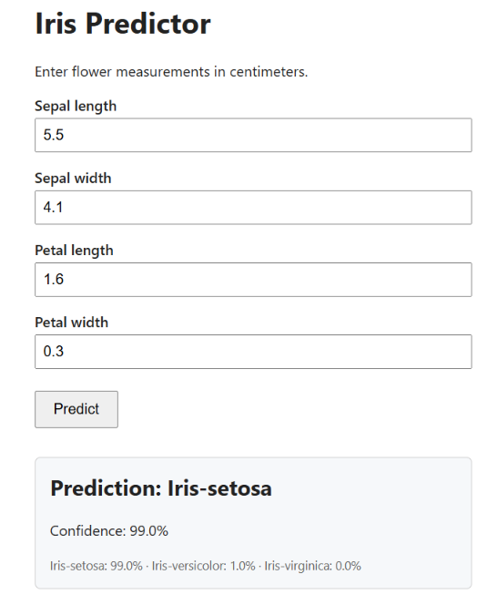

# Iris Predictor: Serving a Machine Learning Model with FastAPI


An end-to-end machine learning demo: train a **Random Forest** classifier on the classic UCI Iris dataset, save it as a pickle file, and serve real-time predictions through a **FastAPI** web app with a clean HTML interface.

<p align="center">
  
</p>

## Features

- **Complete ML workflow:** data loading, training, evaluation, model persistence, and serving
- **Browser-based inference:** enter four measurements, submit, and see the predicted species instantly
- **Class probabilities:** shows the confidence for every class, not just the top prediction
- **Input validation:** FastAPI validates types and value ranges on the server, and the form enforces them in the browser
- **Model loaded once at startup:** uses FastAPI's lifespan handler, so requests never reload the file
- **Reproducible training:** one command downloads the data and rebuilds the model
- **Auto-generated API docs** at `/docs` (Swagger UI)
- **Analysis notebook:** EDA, evaluation, cross-validated model comparison, and an end-to-end check of the saved model and the app

## Tech Stack

| Layer | Technology |
|---|---|
| Web framework | FastAPI, Uvicorn |
| Templating | Jinja2 (server-rendered HTML) |
| Machine learning | scikit-learn (`RandomForestClassifier`) |
| Data handling | pandas |
| Model storage | pickle (`.pkl`) |
| Dataset | [UCI Iris](https://archive.ics.uci.edu/dataset/53/iris) |

## Quick Start

```bash
# 1. Clone the repository and enter the folder
git clone <your-repo-url>
cd iris_app

# 2. Create and activate a virtual environment
python -m venv venv
source venv/bin/activate          # Windows: venv\Scripts\activate

# 3. Install dependencies
pip install -r requirements.txt

# 4. Train the model (downloads the data and creates model/iris_model.pkl)
python train_model.py

# 5. Run the app
uvicorn main:app --reload
```

Open **http://127.0.0.1:8000** in your browser. Interactive API docs are at **http://127.0.0.1:8000/docs**.

## How It Works

```
 iris.data (UCI)                       Browser
      │                                   │  1. submit form
      ▼                                   ▼
 train_model.py ──► model/iris_model.pkl ──► main.py (FastAPI)
  train / evaluate        saved model        2. validate input
  save pickle                                3. predict_proba
                                             4. render index.html
```

1. **Training (`train_model.py`)** reads `data/iris.data` (downloading it from UCI if missing), makes a stratified 80/20 train/test split, trains a Random Forest with 100 trees, prints the test accuracy, and pickles the model.
2. **Startup (`main.py`)** loads the pickle once into memory.
3. **Prediction:** the form posts to `/predict`. The app runs `predict_proba`, picks the most likely class, and re-renders the page with the result and per-class probabilities.

## API Usage

The `/predict` endpoint accepts form data and returns the rendered HTML page. You can also call it from the command line:

```bash
curl -X POST http://127.0.0.1:8000/predict \
  -d "sepal_length=5.5" -d "sepal_width=4.1" \
  -d "petal_length=1.6" -d "petal_width=0.3"
```

| Field | Type | Range |
|---|---|---|
| `sepal_length` | float (cm) | 0 to 20 |
| `sepal_width` | float (cm) | 0 to 20 |
| `petal_length` | float (cm) | 0 to 20 |
| `petal_width` | float (cm) | 0 to 20 |

Values outside the range, or non-numeric input, are rejected by FastAPI with a `422` response.

## Model Analysis Notebook

[`notebooks/iris_analysis.ipynb`](notebooks/iris_analysis.ipynb) documents how the model was built and evaluated:

- Data inspection and exploratory analysis (distributions, class separation, correlations)
- Stratified train/test split and Random Forest training, matching `train_model.py`
- Hold-out metrics: classification report and confusion matrix
- 5-fold cross-validation against Logistic Regression and Decision Tree baselines
- Feature importance
- Verification that the saved `.pkl` matches the notebook model, plus a request to the running app

To run it yourself:

```bash
pip install -r requirements-dev.txt
jupyter notebook notebooks/iris_analysis.ipynb
```

## Project Structure

```
iris_app/
├── main.py               # FastAPI app: loads the model, serves the form and predictions
├── train_model.py        # Data download, training, evaluation, model saving
├── templates/
│   └── index.html        # Jinja2 template for the form and result
├── notebooks/
│   └── iris_analysis.ipynb  # EDA, training, evaluation, and model verification
├── docs/
│   └── results.png    # Screenshot of the result used in this README
├── data/                 # iris.data is stored here (git-ignored)
├── model/                # iris_model.pkl is stored here (git-ignored)
├── requirements.txt
├── requirements-dev.txt  # Adds Jupyter and matplotlib for the notebook
└── .gitignore
```

## Design Decisions

- **Server-rendered HTML instead of a JavaScript frontend:** keeps the demo small and focuses on the model-serving pattern.
- **Random Forest:** a strong default for small tabular data that needs no feature scaling.
- **Generated files are git-ignored:** the model and data are fully reproducible from `train_model.py`, so they stay out of version control.
- **Model and class names saved together:** the pickle stores the class labels next to the model, so the app never hard-codes label order.

## Notes

- Only load `.pkl` files you created yourself or trust. Unpickling untrusted files can execute arbitrary code.
- A pickle needs a scikit-learn version close to the one that created it. If you see a version warning, rerun `python train_model.py`.

## Possible Improvements

- Add a JSON endpoint (`POST /api/predict`) with Pydantic request and response models
- Add unit tests for the endpoints with `pytest` and FastAPI's `TestClient`
- Containerize with Docker
- Track model versions and metrics (for example with MLflow)
- Deploy to a cloud platform such as Render, Railway, or Fly.io

## Data and Citation

The Iris dataset is licensed under [CC BY 4.0](https://creativecommons.org/licenses/by/4.0/legalcode).

> Fisher, R. (1936). *Iris* [Dataset]. UCI Machine Learning Repository. https://doi.org/10.24432/C56C76